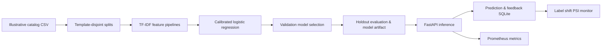

# TaxonomyIQ · Product Classification & MLOps

[](.github/workflows/ci.yml) [](pyproject.toml) [](LICENSE)

**Product catalog categorization**: dataset generation, baseline selection, calibrated classifier, REST and CSV inference, human feedback, drift proxy, and automated evaluation.

## Architecture



## Quick start

Requires **Python 3.11–3.13** and [uv](https://docs.astral.sh/uv/);  run from repository root:

```bash
uv sync --extra dev
uv run taxonomyiq generate-data
uv run taxonomyiq train-evaluate
uv run pytest -q
uv run uvicorn taxonomyiq.api:app --host 127.0.0.1 --port 8000
```

In a new terminal:

```bash
curl -s http://127.0.0.1:8000/health/ready
curl -s -X POST http://127.0.0.1:8000/v1/predict \
  -H 'Content-Type: application/json' \
  -d '{"description":"wireless noise cancelling headphones","request_id":"demo-001"}'
```

Swagger documentation: http://127.0.0.1:8000/docs

## Key capabilities

- **ML:** word and word+character TF-IDF baselines; 3-fold sigmoid probability calibration; validation-based model selection; separate held-out test split (template families never cross splits)
- **Evaluation:** macro-F1, per-class precision/recall, confusion matrix, log loss, ECE, batch inference latency, confidence/abstention coverage
- **Serving:** `POST /v1/predict`, `POST /v1/predict/batch` (200 maximum), `POST /v1/feedback`, `GET /v1/monitor/drift`, readiness and Prometheus metrics
- **Operations:** immutable model version in responses, request-ID idempotent logging, Docker, CI, benchmark script, access-key gate for exposed deployments
- **Experiment tracking:** optional local MLflow runs (`TAXONOMYIQ_TRACK_MLFLOW=1` with `mlops` extra)
- **Advanced experiment:** actual Hugging Face DistilBERT fine-tuning entry point under optional `transformers` extra; separate from the default CPU model

## Measured results

See [`reports/evaluation.json`](reports/evaluation.json) and [`reports/api_benchmark.json`](reports/api_benchmark.json) for **actually executed synthetic holdout** and local benchmarking results.

## Docker

```bash
docker compose up --build
```
